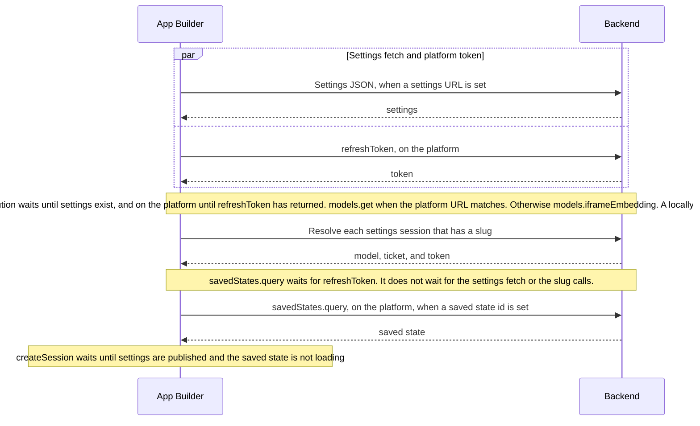

# App Builder load

This is the controller load, from starting the app to a scene. Settings resolution is the first diagram. The load sequence starts once those waits have finished. Instance sessions and secondary sessions are separate diagrams.

## Settings

App Builder and the backend. An arrow to the backend is a server wait. The two calls in the parallel block start together.

Off the platform there is no `refreshToken` and no `savedStates.query`. The saved-state withhold ends when the id is in the store, or when `currentModel` is set and the id is missing. A ticket session that never sets `currentModel` stays withheld, so `createSession` does not start.

## Load

Three lanes. A gray band is one viewer call, from the request until that call returns. An arrow to the backend is a server wait.

```mermaid
sequenceDiagram
  participant App as App Builder
  participant Viewer as Viewer
  participant Backend as Backend

  Note over App: Settings are resolved. loadOnFirstUse leaves the session pending and the loader up.

  rect rgb(51, 65, 85)
    App->>Viewer: createSession
    Note over Viewer: task.start session_creation: Creating session
    Viewer->>Backend: createSessionByTicket or createSessionByModel
    Backend-->>Viewer: session
    Note over Viewer: While an output still has delay, the viewer waits, then calls getCachedOutputs, and tries again
    Viewer->>Backend: getCachedOutputs, when an output has delay
    Backend-->>Viewer: cached outputs
    Viewer->>Backend: glb and gltf content, plus material textures and tag3d fonts when that content is present
    Backend-->>Viewer: content
    Note over Viewer: session.initialOutputsLoaded, then task.end, then session.created
    Viewer-->>App: createSession returns
  end

  Note over App: Session API exists. The loader is replaced by the UI. appready listeners start. A host with no viewport runs the slot here.
  Note over App: ShapeDiver appready runs after createViewport returns. A cleared suspend flag may already have updated the scene. A non-empty box makes the wait return before it listens for scene events. An empty box returns on that check when every session already has a node. Otherwise the wait stays on the scene events.

  rect rgb(51, 65, 85)
    App->>Viewer: createViewport
    Note over Viewer: task.start viewer_creation: Creating viewport
    Viewer->>Backend: environment map, unless null or none, and the blue noise texture. Together, when a session with id default exists
    Note over Viewer: settingsAssigned resolves, and the suspended scene update runs, when the environment map settles. Blue noise can still be in flight. show stays false
    Backend-->>Viewer: both downloads finished
    Note over Viewer: viewport.created, then task.end: Viewport created. The call returns after task.end
    Viewer-->>App: createViewport returns
  end

  Note over App,Viewer: The initial suspend flag clears when the viewport access functions are registered. If an instances process is already flagged, the scene update waits until the instances are in the controller node.

  rect rgb(51, 65, 85)
    Viewer->>Viewer: RenderingEngine.update
    Note over Viewer: scene.boundingBoxChange with a non-empty box, or scene.boundingBoxEmpty
    Note over Viewer: show is set during this call only in the cases in the table
  end

  Note over Viewer: viewport.visible on the frame after the first frame that sees show
```

`appready` listeners start at **Session API exists. The loader is replaced by the UI**. A host with no viewport runs the slot there. ShapeDiver waits until the viewport access functions exist, which is after `createViewport` returns. Registering them can drop a suspend flag that was waiting for those functions, and that runs the scene update before `waitUntilReady`. A process that is still running keeps the flag set. If the box is non-empty, `waitUntilReady` returns immediately and does not listen for **scene.boundingBoxChange with a non-empty box**, **scene.boundingBoxEmpty**, or **viewport.created**. If the box is still empty, and every session already has a node, it returns on that check. Otherwise it stays on those scene events. Another host can replace the wait with its own `waitUntilReady`.

## When show is set

`viewport.visible` is the frame after the first frame that sees `show`. The first of those frames arms the logo handoff. It is not part of `RenderingEngine.update`.

| Visibility | Box when `createViewport` checks | What sets `show` |
| --- | --- | --- |
| `session` | Already non-empty | `showAfterSettingsAssignment` when `settingsAssigned` resolves. No bounding-box listener. |
| `session` | Empty | The listener on `scene.boundingBoxChange`. A non-empty change sets `show` true once `settingsAssigned` is resolved. An empty change sets `show` false. `scene.boundingBoxEmpty` does not set `show`. It is emitted only when every session has `initialOutputsLoaded` resolved. |
| `sessions` | Either | `showAfterSettingsAssignment` after `settings.sessions` without `instance`, after the first, have been created, and `settingsAssigned` is resolved. The box is not checked. `createViewport` does not wait for those sessions. |

Secondary sessions are `settings.sessions.filter(session => !session.instance).slice(1)`. The controller id is not in that list. An empty list leaves visibility at `session`. `ViewportComponent` sets `visibility` to `sessions` only when the list is not empty. The viewer does not read settings.

On this controller load the scene update inside `createViewport` does not apply. `useSessionWithAppBuilder` has a process manager in status `CREATED` before the viewport exists, and `useViewport` passes `SUSPEND_SCENE_UPDATES` for a manager that is `CREATED` or `RUNNING`. `RenderingEngine.update` returns without applying the scene, so the box stays empty and `createViewport` does not set `show` before it returns. The update that applies the scene is the one after that call returns, when the suspend flag clears.

Without a session id `default`, `createViewport` does not download the environment map or the blue noise texture, and `settingsAssigned` stays unresolved until a later session with that id applies its settings. In visibility `session`, `show` then follows the table. In visibility `sessions`, `show` is set once those sessions have been created and `settingsAssigned` is resolved.

When `loadOutputs` is false, `createSession` does not download output content and does not emit `session.initialOutputsLoaded`. The AppBuilder output content is not parsed. A settings override is still applied. When `waitForOutputs` is false, `updateOutputs` is started before `session.created` and is not awaited. `session.initialOutputsLoaded` and `viewport.update` run after that promise returns. That update runs on viewport engines that are already stored. An engine is stored before `createViewport` returns, so a call that settles during creation is included, and a call that settles earlier is not. While scene updates are suspended, it returns without applying the scene.

The output callback runs only when an output named `AppBuilder` exists. A settings override is applied without parsing the output JSON. Otherwise the callback parses the output content from the session response. `glb` and `gltf` content is downloaded from its `href`. External images and buffers are loaded for non-binary glTF. `sdtf` is skipped unless `loadSdtf` is set. Plain `data` content, including that AppBuilder output, is already on the session response.

An invalid `context` parameter makes the store call `createSession` a second time without `context`.

Settings sessions other than the controller finish their platform calls before the controller `createSession`. JSON `sessions` and `instances` are resolved after the controller session API exists. A settings session with `instance` set is started with `loadOutputs` and `registerParametersAndExports` false. Its id is not passed to the viewport. An instances process suspends the scene update when that process is already flagged before the initial suspend flag is removed.
