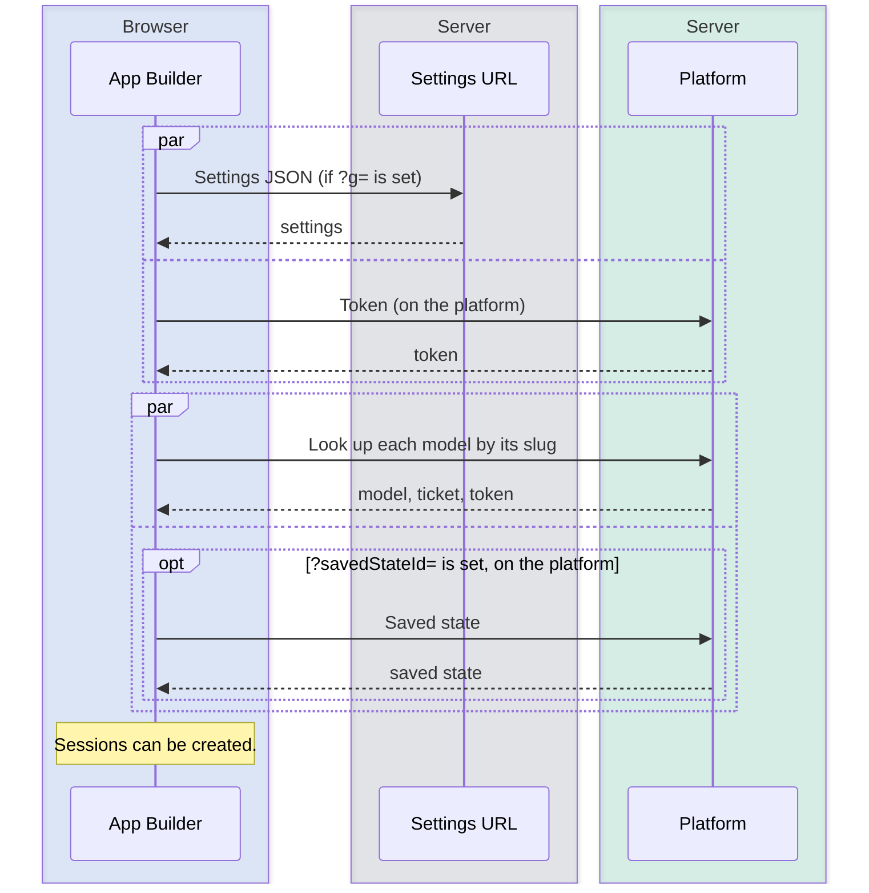
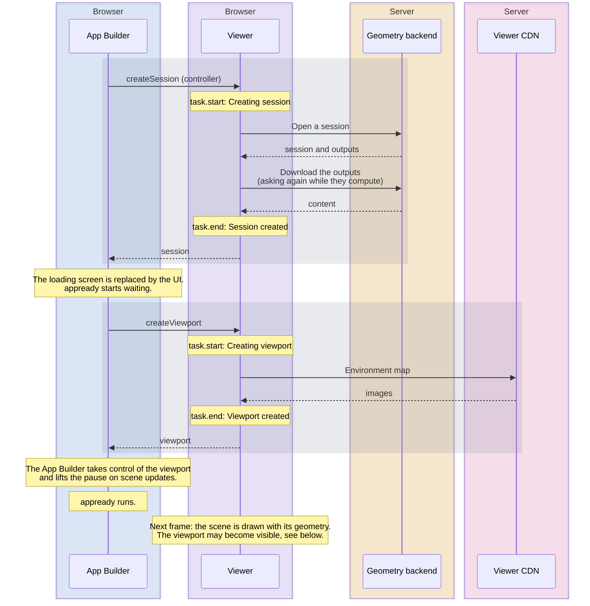

# App Builder load

What happens from opening the app until the scene is visible and the `appready` action slot has run.

**In short:**

- First the App Builder loads the settings and looks up the models on the platform.
- Then it opens the controller session, creates the viewport, and draws the scene.
- `appready` runs as soon as the App Builder controls the viewport. For a normal model the scene already has its geometry then. It does not wait for geometry that comes later, for example from instances.
- The viewport is shown once there is geometry, or (with secondary sessions) once those sessions are created.

## How to read the diagrams

Blue: App Builder, purple: Viewer (both in the browser). The other colors are servers: gray for the settings URL, green for the ShapeDiver platform, amber for the geometry backend, pink for the Viewer CDN (`viewer.shapediver.com`). A gray band is one Viewer call, from the request until it returns.

## 1. Settings

- **Settings JSON:** only when the URL has `?g=<settings url>`.
- **Token:** only when running on the platform.
- **Model lookups:** each session with a slug is looked up on the platform: with `models.get` when the app runs on the same platform as the session, with `models.iframeEmbedding` otherwise. A session with a ticket and `modelViewUrl` needs no lookup. If a lookup for a session from the settings fails, the page shows an error.
- **Saved state** (`?savedStateId=`): on the platform it is a separate request. Elsewhere it comes with the `models.iframeEmbedding` lookup. No session starts until it is loaded. Its values go to the first session.
- **URL values:** `?context=` and `?_<parameter>=<value>` go to every session and win over the saved state. `?modelStateId=` sets a model state on the session from the URL or settings JSON, unless that session already sets one.

## 2. Load

### Opening the session

- **Other sessions from the settings** are opened at the same time as the controller. Sessions and instances from the `AppBuilder` output start only after the controller is open.
- **Events:** `task.start` (`Creating session`), `task.process` (`Initializing session.`), `task.process` (`Output content loading progress.`, repeated), `session.initialOutputsLoaded`, `task.end` (`Session created`), `session.created`.
- **The app definition** comes from the output named `AppBuilder`. An `appBuilderOverride` in the settings wins over it. With neither, the default UI is used.

### Creating the viewport

- **The viewport is created after the controller session is open.**
- **It starts paused.** The App Builder lifts the pause once the viewport is registered and the `AppBuilder` output has been checked. That triggers the first draw.
- **Instances** that are still computing at that point keep the scene paused until they are placed.

## Errors

| Where it fails                                | What the user sees                                                                                                                                                |
| --------------------------------------------- | ----------------------------------------------------------------------------------------------------------------------------------------------------------------- |
| Token request on the platform                 | The browser goes to the login page. With `?redirect=0`, or when `?savedStateId=` is set, loading continues without a token, and private models then fail to load. |
| Settings, model lookup, or controller session | An error page instead of the loading screen.                                                                                                                      |
| `AppBuilder` output that is not valid JSON    | An error page instead of the whole app.                                                                                                                           |
| Creating the viewport                         | An error inside the viewport area only.                                                                                                                           |
| Opening a secondary session from the settings | Nothing visible. In `sessions` mode the viewport stays hidden.                                                                                                    |
| A session from the `AppBuilder` output        | Nothing visible, only a warning in the console.                                                                                                                   |

With `?savedStateId=` there is no login redirect, on purpose: [links to public saved states](https://help.shapediver.com/doc/saved-states) must open for anyone, also without a ShapeDiver account. A logged-out visitor with a link to a private model therefore sees an error page, not the login page. A private saved state is skipped, and the model opens without its values.

## When appready runs

`appready` is a root action slot. It runs once per controller session. See [Action slots](action-slots.md).

1. **It waits until the app definition is parsed** and contains an `appready` slot.
2. **Without a viewport component** (a host that renders no viewport), it runs right away.
3. **With a viewport**, it waits until the viewport is created and the App Builder has control of it. Then it runs, whether or not the scene has geometry yet.
    - **Normal model:** the controller waits for its outputs before `createSession` returns, so the scene already has geometry when `appready` runs.
    - **Empty controller scene:** in apps where the geometry comes from instances, or with `waitForOutputs: false`, `appready` runs while the scene is still empty. A `zoomTo` in the slot then frames nothing. Once instances are first placed, the App Builder fits the camera itself if the camera has `autoAdjust` or the viewport has `initialAutoAdjust`.

## When the viewport is shown

The viewport stays hidden until the Viewer sets `show`. `viewport.visible` fires one frame later.

| Visibility                                        | When `show` is set                                                |
| ------------------------------------------------- | ----------------------------------------------------------------- |
| `session` (default)                               | When the scene first gets geometry.                               |
| `sessions` (the settings have secondary sessions) | When every secondary session is created. Geometry is not checked. |

Secondary sessions are the settings sessions after the first, without `instance: true`. In both modes the viewport's scene settings must be applied first. Watch out for:

- **An empty model** is never shown in `session` mode.
- **A secondary session that fails** keeps the viewport hidden in `sessions` mode, because that session is never created. A `loadOnFirstUse` secondary session keeps it hidden until an instance uses it.
- **A session with id `default` is required.** The viewport takes its scene settings (environment map, lighting) from that session. Without it the settings are never applied and the viewport is never shown. A controller from URL parameters gets the id `default`. Sessions from a settings JSON keep their own id, so this is the usual way to hit the problem. To use another session, set `sessionSettingsMode` and `sessionSettingsId` on `ViewportComponent` in the theme.

## Special cases

- **`loadOnFirstUse`:** the session is opened only when an instance in the `AppBuilder` output uses it. For the controller, the loading screen stays forever.
- **`loadOutputs: false`:** the session downloads no geometry. Instance sessions always use this.
- **`waitForOutputs: false`:** the session returns before its geometry is downloaded. The scene updates when the download finishes.
