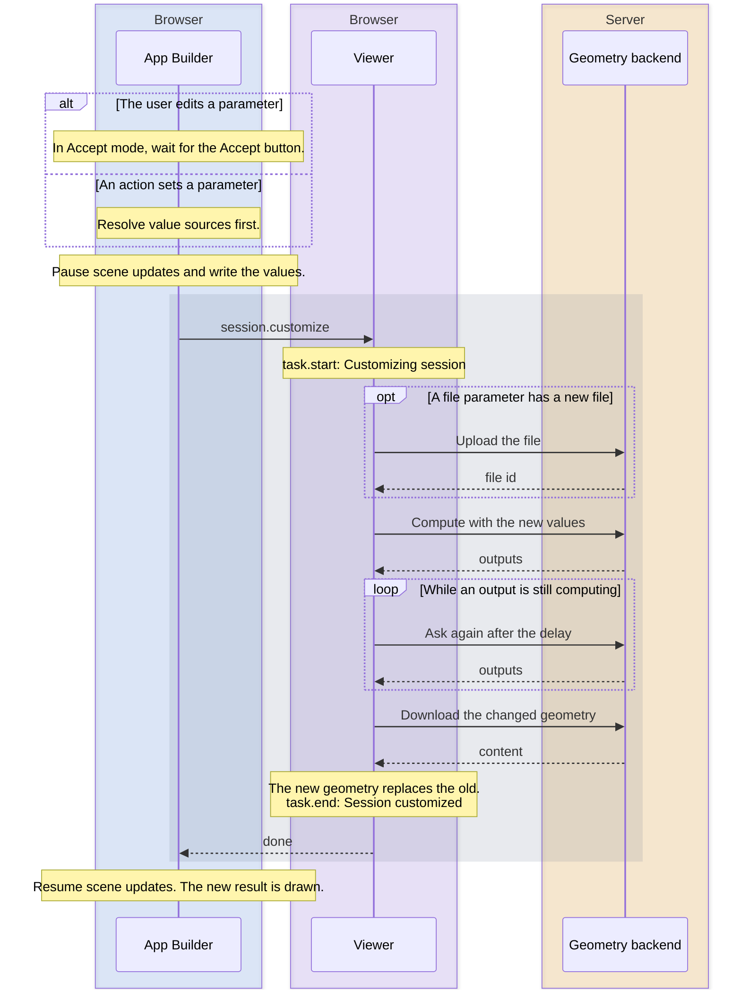
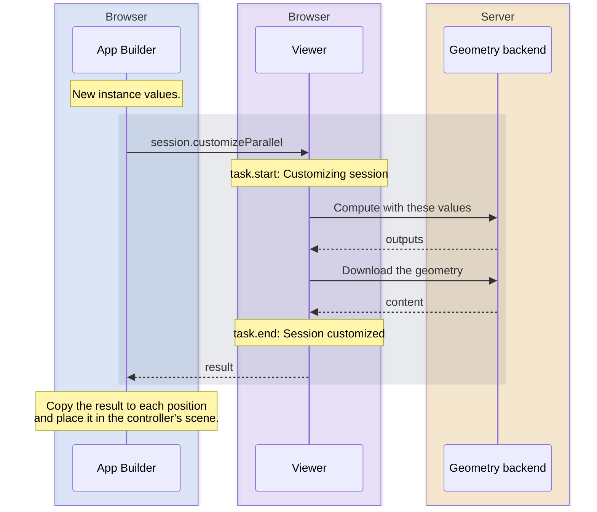

# Session customization

What happens when a parameter change recomputes a session, from the edit to the updated scene.

**In short:**

- The App Builder pauses scene updates, sends the new values, and the Viewer asks the geometry backend for the new result.
- The Viewer downloads the changed geometry and swaps it in. The scene is drawn when the App Builder resumes updates.
- A newer change cancels an older one that is still running.
- Instances work differently: each value set is computed in parallel, without changing the session's own values or scene.

## How to read the diagrams

Blue: App Builder, purple: Viewer (both in the browser), amber: geometry backend (server). A gray band is one Viewer call, from the request until it returns.

## Controller and secondary sessions

Secondary sessions work exactly like the controller. Only `data.sessionId` is different.



### Step by step

- **When the change is sent:**
    - Most controls send as soon as the edit ends, for example when a slider is released. Text inputs send after a typing pause (2 seconds by default), on blur, or on Enter.
    - In Accept mode, user edits wait for the Accept button.
    - An action (`setParameterValue` or `setParameterValues`) is sent right away, even in Accept mode. It also sends any user edits of that session still waiting for Accept.
- **Value sources** (for example an export result as a file) are resolved before anything is sent. See [Parameter value sources](value-sources.md).
- **While it runs,** the viewports don't redraw, so no half-finished result is shown, and the session's controls are disabled.
- **No change:** if no value changed, nothing is computed and no events are emitted. An action skips literal values that equal the current value; values from a source are always sent.
- **Only changed geometry is downloaded.** Outputs whose version did not change are kept.
- **On an error,** the App Builder puts the previous values back.

### Events

In order:

1. `task.start` (`Customizing session`)
2. `task.process` (`Uploading file parameters`), also when no file changed
3. `task.process` (`Sending customization request`)
4. `task.process` (`Output content loading progress.`), while geometry downloads
5. `task.process` (`Updating scene`)
6. `output.updated`, once per changed output
7. `session.customized`
8. `task.end` (`Session customized`)

The `task.*` events have type `session_customization`, category `customize`, and `data.sessionId` set to the session id (the one the action slot filter matches).

### How it ends

| Outcome                | Last task event                                                            | Action slot        |
| ---------------------- | -------------------------------------------------------------------------- | ------------------ |
| Success                | `task.end`                                                                 | `computationend`   |
| No value changed       | None                                                                       | None               |
| A newer change started | `task.cancel`: `The request was exceeded by another customization request` | None               |
| Error                  | `task.cancel`: `Session customization failed`                              | `computationerror` |

- **A newer change** cancels the older one. The older one never gets `task.end`. The newer one starts with its own `task.start`.
- **Errors:** an expired session, or an invalid token when a token refresh is configured, is retried up to 3 times. Other errors end the customization right away. Every error also emits `session.error`.

## With default exports

If a session has default exports, the App Builder computes outputs and exports in one call: `session.requestExports`. Today only the image export widget sets default exports.

It works like the diagram above, except:

- The category is `customize_via_exports`.
- It always runs, even if no value changed.
- If two requests overlap, the one answered last wins, even if it is older. This only happens with actions, because controls are disabled while computing.
- A replaced request still runs `computationend`. A retried error runs `computationerror` and then `computationstart` again.
- It does not run the `export*` slots.

## Instances

An instance computation runs in parallel. It does not change the session's own values or scene, so several results can exist at once. See [Sessions and instances](sessions-and-instances.md).

Each distinct value set is computed once and reused. Values equal to the session's own reuse the session's result. If that still needs downloading, the download runs no `computation*` slot.



Compared to a normal customization, an instance computation:

- is never cancelled by a newer change,
- on an error only runs `computationstart`, with no `computationend` or `computationerror` after it.

## Action slots

`computationstart`, `computationend`, and `computationerror` are root action slots. See [Action slots](action-slots.md).

| Slot               | Runs on                                                    |
| ------------------ | ---------------------------------------------------------- |
| `computationstart` | Every `task.start` of a customization                      |
| `computationend`   | Every `task.end` of a customization                        |
| `computationerror` | A `task.cancel` with status `Session customization failed` |

Filter by session with `eventProps`. `type` must be `"session"`, and `props` is required. Any other `type` is a validation error. The slots go into the root `actionSlots` object:

```json
"actionSlots": {
	"computationend": {
		"eventProps": {"type": "session", "props": {"sessionId": "table"}},
		"action": {"type": "..."}
	}
}
```

A slot has one `action`. For several, use an `executeActions` action. To react to several sessions, use an array of slots.

- **Without a filter,** only the controller counts. An instance computation only runs the slots when the filter names the instance's session.
- **Default exports and instance computations** count too.
- **A cancelled customization** runs `computationstart`, but neither `computationend` nor `computationerror`. Exception: default exports still run `computationend`.
