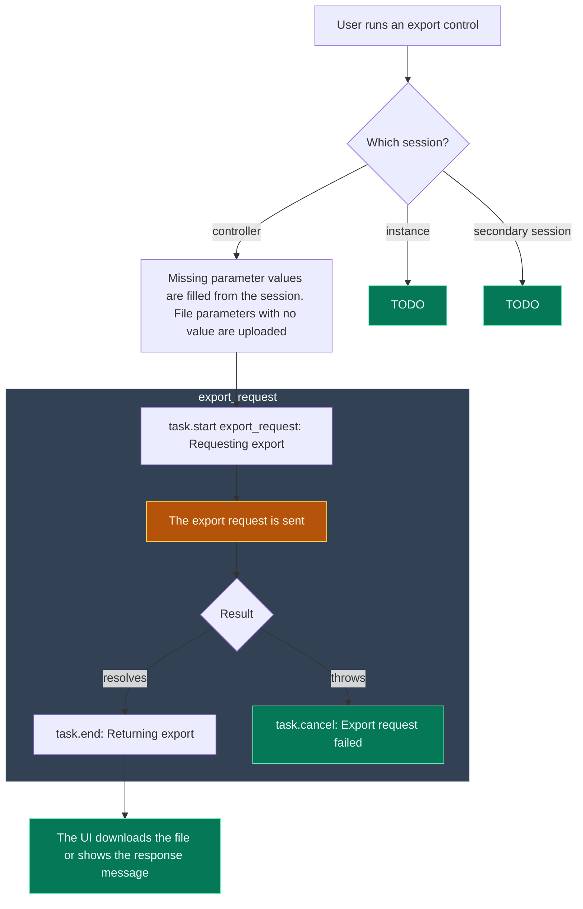
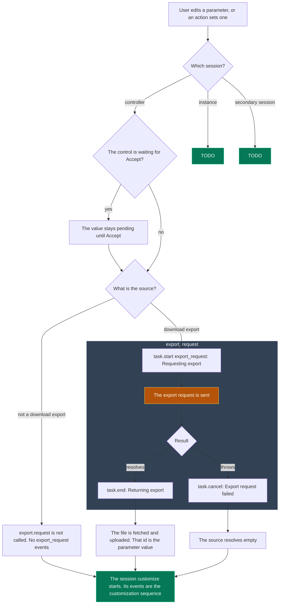

# Export request

`export.request` is the call that emits `export_request`. `session.requestExports` does not. When that batch call also loads outputs, it is a session customization instead, in [Session customization](action-slots-computation.md).

The task data is `sessionId`, `exportId`, `name`, and `displayname`. Gray boxes are processes on the viewer. Amber nodes are backend calls made from that process. Green nodes are where a path ends.

## From an export control

## From a parameter value source

