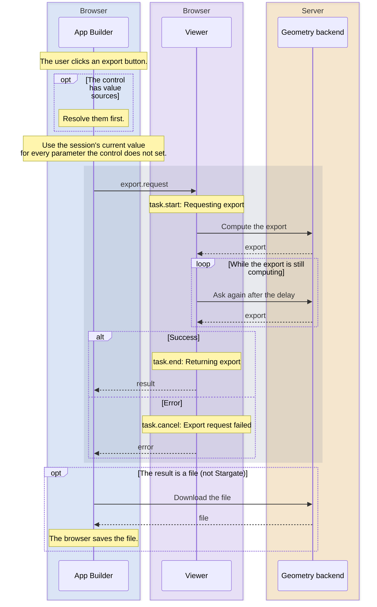
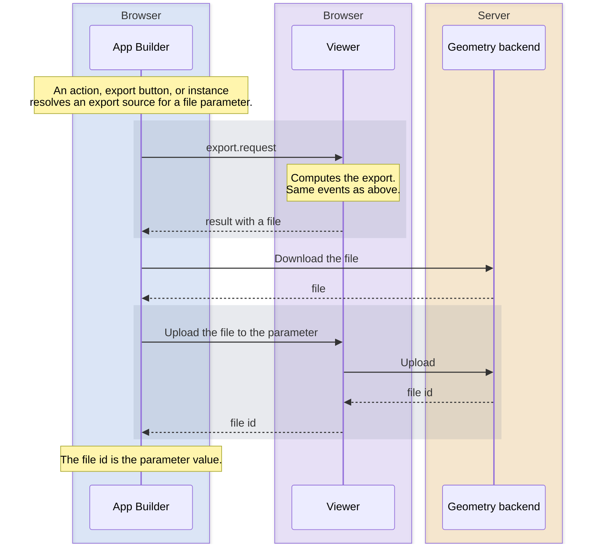

# Export request

What happens when the App Builder requests an export, from the trigger to the file or message the user gets.

**In short:**

- An export starts from an **export control** (a button), or from an **export value source** (an export used as a file parameter value).
- The Viewer sends the current parameter values to the geometry backend, which computes the export.
- The App Builder downloads the file, shows a message, or uses the file as a parameter value.

## How to read the diagrams

Blue: App Builder, purple: Viewer (both in the browser), amber: geometry backend (server). A gray band is one Viewer call, from the request until it returns.

## From an export control



### Step by step

- **Pending changes disable the button.** While a parameter of that session has a change that is not sent yet (still being edited, or waiting for Accept), the button cannot be clicked.
- **Values:** the control's own `parameterValues` win. Every other parameter uses the session's current value. Empty values in the control's `parameterValues` are ignored.
- **`sessionId` on a value:** all values go to the export's session. On a value source, `sessionId` picks the session of the target file parameter.
- **In a form,** the form's values are sent instead of the control's `parameterValues`. Only if the control also has value sources are both used, and then a form value wins over a control value with the same parameter id.
- **Files:** local files are uploaded first, and their ids are stored on the session.
- **Waiting:** if the export takes longer, the Viewer waits and asks again, by default for up to 5 minutes.
- **Retries:** if the session expired or the token is invalid, the Viewer retries up to 3 times.

### Events

`task.start` (`Requesting export`), then either `task.end` (`Returning export`) or `task.cancel` (`Export request failed`). There is no progress event in between.

The task type is `export_request`. The task data has `sessionId`, `exportId`, `name`, and `displayname`.

### What the user sees

| Result                                                                                            | What happens                                                                                                                                                                             |
| ------------------------------------------------------------------------------------------------- | ---------------------------------------------------------------------------------------------------------------------------------------------------------------------------------------- |
| Download export with a file                                                                       | A "Downloading file" message, then the file is saved.                                                                                                                                    |
| Download export with only a message                                                               | A success message.                                                                                                                                                                       |
| Email export                                                                                      | A success or error message.                                                                                                                                                              |
| Stargate export (download export whose display name, or name if there is none, starts with `SG_`) | It is sent to the connected ShapeDiver desktop client, which uses the session's current values. A second button downloads the file. Without a compatible client, the button is disabled. |
| Unexpected response                                                                               | An error message.                                                                                                                                                                        |
| `export.request` fails                                                                            | **No message.** Use the `exporterror` slot.                                                                                                                                              |

Errors shown after a successful request (an email error, an unexpected response) still run `exportend`, not `exporterror`.

## From an export value source

An export value source fills a **file parameter** with an export's file. For all source types, see [Parameter value sources](value-sources.md). It is used in a `setParameterValue` or `setParameterValues` action, in the `parameterValues` of an export control or toolbar export button, or in an instance's `parameterValues`. Editing a parameter in the UI never uses it.



The diagram shows the main case. All outcomes:

| Case                                                      | Value                                  |
| --------------------------------------------------------- | -------------------------------------- |
| Download export that returns a file                       | The uploaded file's id (diagram above) |
| Download export that returns only a message               | The message                            |
| The export fails                                          | Empty                                  |
| Not a download export, not found, or not a file parameter | Empty, no request                      |

- **No pending-changes check** applies here.
- **Other sessions:** a source can use another session's export (`sessionId`), and sources can be nested.
- **What happens next** depends on where the source is used:
    - **Action:** the value is written right away and the session recomputes. See [Session customization](computation-flow.md).
    - **Export control or toolbar button:** the value goes into that export request. A failed or empty source is left out, so the session's current value is used.
    - **Instance:** the value goes into the instance's values. A failed source becomes empty.

## Other ways exports are requested

- **Toolbar export buttons** work like export controls, without Stargate and without forms.
- **Model state images and the filterable database** also call `export.request` and run the `export*` slots.
- **The image export widget** usually gets its result with each computation (as a default export), so the `computation*` slots run for it, not `export*`. See [Session customization](computation-flow.md#with-default-exports).

## Action slots

`exportstart`, `exportend`, and `exporterror` are root action slots. See [Action slots](action-slots.md).

| Slot          | Runs on                            |
| ------------- | ---------------------------------- |
| `exportstart` | `task.start` of an export request  |
| `exportend`   | `task.end` of an export request    |
| `exporterror` | `task.cancel` of an export request |

Filter with `eventProps`. `type` must be `"export"`, and `props` is required. The slots go into the root `actionSlots` object:

```json
"actionSlots": {
	"exportend": {
		"eventProps": {"type": "export", "props": {"sessionId": "table", "name": "PDF"}},
		"action": {"type": "..."}
	}
}
```

To react to several exports differently, use an array of slots, each with its own `eventProps`.

- **`sessionId`:** which session. Without it, only the controller counts.
- **`name`:** the export's id, name, or display name (not case-sensitive). Without it, every export of that session counts.

## Instances

Instances have no export buttons, because their sessions do not register exports. An export value source can still use an instance session's export.
