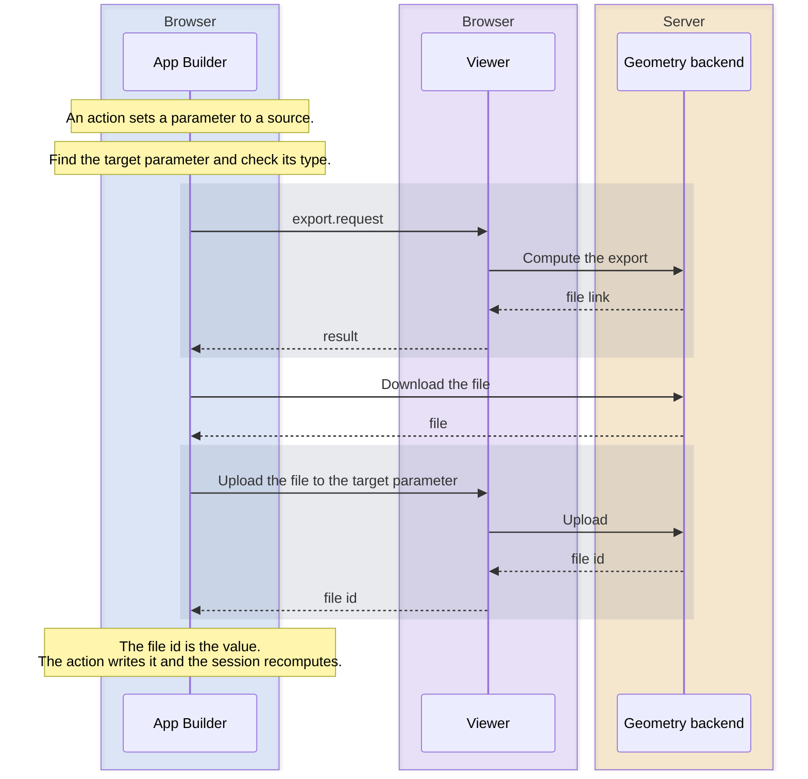

# Parameter value sources

A value source computes a parameter value at runtime instead of using a fixed string, for example "the file of this export" or "a screenshot of the viewport".

**In short:**

- A source is an object with a `type` and `props`. In actions and export buttons it goes in the entry's `source` field instead of `value`. Set only one of them; setting both can give wrong values in export controls. In instance `parameterValues` and nested export `parameterValues`, the source replaces the literal value.
- Five types work in configs: `dataOutput`, `export`, `sdtf`, `modelState`, and `screenshot`. Each one only fits certain parameter types.
- Sources work in `setParameterValue(s)` actions, in the `parameterValues` of export controls and toolbar export buttons, and in instance `parameterValues`.
- All sources of one request are resolved before anything is sent. A source that fails gives no value.

## How to read the diagram

Blue: App Builder, purple: Viewer (both in the browser), amber: geometry backend (server). A gray band is one Viewer call, from the request until it returns.

## Resolving a source

The example is a `setParameterValue` action whose value comes from an export.

All types work this way. Only how the value is computed differs.

## Types

| Type         | Target parameter    | Value                                                                                                    | Reads from                                |
| ------------ | ------------------- | -------------------------------------------------------------------------------------------------------- | ----------------------------------------- |
| `dataOutput` | String or File      | The output's content as JSON `{"content":[...]}`. For a File parameter it is uploaded as a `.json` file. | Output `name`                             |
| `export`     | File                | The exported file, uploaded to the parameter. If the export returns only a message, the message.         | Export `name` (must be a download export) |
| `sdtf`       | sdTF types (`s...`) | The output's sdTF, uploaded to the target parameter's session. Optional `chunk` picks a chunk.           | Output `name`                             |
| `modelState` | String              | A link to a new model state.                                                                             | The caller's session                      |
| `screenshot` | File                | A screenshot, uploaded to the parameter. Optional screenshot settings.                                   | A viewport (see below)                    |

- **`name`** is the id, name, or display name.
- **`sessionId`** (for `dataOutput`, `export`, and `sdtf`) is optional. Without it, the source reads from the caller's session (see [Callers](#callers)).
- **File targets** must accept the file's type: JSON for `dataOutput`, the export's format, or the screenshot's `contentType` (PNG by default). Otherwise the upload fails and the source gives no value.
- **`export` with `parameterValues`:** values sent with the export. Other parameters use the export session's current values. The values can be sources too (see [Nesting](#nesting)).
- **`modelState`** takes the props of the `createModelState` action, plus `updateUrl`.
- **`screenshot` viewport:** actions use the viewport they run in, and the source fails if it doesn't exist. Toolbar buttons use the first viewport. Export controls and instances use the viewport of their context, and if it doesn't exist they currently hang: the export keeps loading, or the instances are not created.

## Callers

| Caller                                                    | Session used when `sessionId` is omitted      | A failed source                                               |
| --------------------------------------------------------- | --------------------------------------------- | ------------------------------------------------------------- |
| `setParameterValue(s)` action                             | The action's session (usually the controller) | Becomes `""`. If that is not a valid value, the action fails. |
| Export control `parameterValues` (also a form's `export`) | The export's session                          | Left out, so the session's current value is used.             |
| Toolbar export button `parameterValues`                   | The export's session                          | Left out, so the session's current value is used.             |
| Instance `parameterValues`                                | The controller                                | Becomes `""`.                                                 |

- **The target parameter** is looked up in `parameter.sessionId` of the entry, or in the caller's session. For instances it is the instance's `sessionId`. In export controls and toolbar buttons, values always go to the export's session, so leave `parameter.sessionId` unset there.
- **Actions** write the result right away (also in Accept mode), and the session recomputes. See [Session customization](computation-flow.md).
- **Export controls and toolbar buttons** resolve their sources on click and pass the results to the export request. In a form, a form field for the same parameter (by id) overrides the source. See [Export request](export-flow.md).
- **Instances** resolve their sources each time the instance list changes.
- **Not supported:** `initialParameterValues` of a session only takes strings.

## Nesting

Only an `export` source can contain other sources, in its `parameterValues`.

- **Order:** nested sources are resolved first.
- **Sessions:** a nested source's target parameter is looked up in the export's `sessionId`, or else in the session of the parent entry. Its data still comes from the caller's session unless the nested source sets its own `sessionId`.

## Pitfalls

- **Identical sources are resolved once.** Two entries with the same `type` and `props` share one result. Make them differ if each target needs its own upload or model state.
- **Wrong target** (a missing parameter, or the wrong type): an action fails for a missing parameter. With the wrong type it writes `""` and fails only if that is not valid. Elsewhere a warning is logged, and the entry is handled like a failed source.
- **The sdTF chunk** must match the parameter type, otherwise Grasshopper receives no data.
